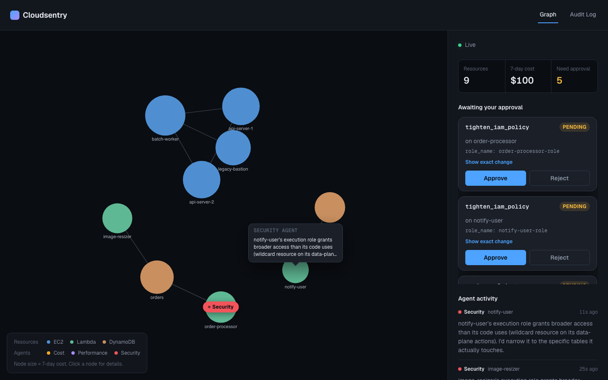

# Cloudsentry

**Your AWS account as a live graph, watched by three AI agents.**

[](https://github.com/Sakar1601/cloudsentry/actions/workflows/ci.yml)

Cloudsentry reads a real AWS account (EC2, Lambda, DynamoDB, CloudWatch, Cost Explorer, IAM) and draws it as a
force-directed graph. Three Claude-powered agents — **Cost**, **Performance** and **Security** — continuously pick a
node, call real AWS APIs, write a plain-language finding, and propose a fix. **Nothing changes in your account until a
human approves it**, and every decision is logged.

### [▶ Try the live demo](https://sakar1601.github.io/cloudsentry/)

It runs entirely in your browser against a simulated account: no install, no sign-up, no credentials.


## What it looks like

| The working app: graph, approvals queue, agent activity | Audit log with the exact change and outcome |
|---|---|
|  |  |

*(The app screenshot is the real FastAPI backend in demo mode, so it shows no real account data.)*

## How a cycle works

1. **Observe.** A poller reads the account every 30 s, builds a graph (nodes: EC2, Lambda, DynamoDB; edges: shared
   VPC, Lambda env-var references, IAM access), diffs it against the last snapshot, and streams only the changes to
   the browser over a WebSocket.
2. **Investigate.** Each agent picks the node worth a look — Cost and Performance choose a node running more than
   1.5× above its own rolling baseline; Security walks the Lambda functions in rotation — and its marker travels there.
   It then runs a bounded Claude tool-use loop (max 5 calls) over a toolset scoped to its job.
3. **Conclude.** The loop ends in a 2–3 sentence finding, pinned to the node it is about.
4. **Propose.** If a fix applies, the agent calls an *action tool*. Action tools never touch AWS; they write a pending
   action (exact parameters + reasoning) to SQLite.
5. **Approve.** A person reviews the exact change. Only the approve endpoint executes it, through a separate executor
   that calls boto3; the outcome is stored and shown in the audit log. Reject, and nothing runs.

| Agent | Investigates when | Reads with | Can only propose |
|---|---|---|---|
| Cost | 7-day cost > 1.5× rolling baseline | `get_cost_and_usage`, `list_ec2_instances`, `list_lambda_functions` | `stop_ec2_instance` |
| Performance | primary CloudWatch metric > 1.5× baseline | `get_cloudwatch_metric`, `get_cloudwatch_logs`, `list_lambda_functions`, `list_ec2_instances` | `resize_ec2_instance` |
| Security | each Lambda in rotation | `get_iam_policy_for_role`, `list_ec2_instances`, `list_lambda_functions` | `tighten_iam_policy` |

## Safety model

Letting a language model near an AWS account is only reasonable if the dangerous step is not its to take. That is
enforced in code and in IAM, not in a prompt:

- Action tools are inert: they record intent and return a pending action.
- Execution lives in one place (`POST /actions/{id}/approve`); approving twice returns `409`.
- The Terraform task role limits writes to EC2 instances tagged `CloudsentryManaged=true`, and IAM edits exclude
  roles ending in `-admin` or containing `-critical-`. This is demo-grade least privilege and
  [`infra/terraform/iam/main.tf`](infra/terraform/iam/main.tf) says so; production would add a permissions boundary.
- Every proposal keeps its agent, node, parameters, reasoning, status, timestamps and result.

## Architecture


```
Next.js UI ◄── WebSocket: graph deltas, agent moves, findings, proposals ──┐
           ── REST: approve / reject / audit ─────────────► FastAPI ───────┤
                                                                           │
Graph poller ── boto3 reads ──► in-memory graph ──► diff ──► broadcast ────┤
Agent swarm (Cost │ Performance │ Security) ── Claude tool use ────────────┤
Action store (SQLite) ──► approve ──► executor ──► boto3 write (gated) ────┘
```

Full design: [docs/spec.md](docs/spec.md).

## Run it

### 1. Static demo (nothing to install)

Hosted at the link above. To build it yourself: `make static` (output in `frontend/out/`).
It uses a TypeScript simulator ([`frontend/lib/demo/engine.ts`](frontend/lib/demo/engine.ts)) behind
[`frontend/lib/api.ts`](frontend/lib/api.ts), selected by `NEXT_PUBLIC_STATIC_DEMO=1`.

### 2. Full stack, no credentials

```bash
docker compose up --build        # http://localhost:3000
```

The real backend runs in **demo mode** (`CLOUDSENTRY_DEMO=1`): a fictional account and scripted agents run through the
*same* poller, WebSocket stream, action store and approval API; only the AWS and LLM calls are swapped
([`backend/app/demo/`](backend/app/demo/)). Approving an action is simulated. Without Docker: `make install`, then
`make backend` and `make frontend` in two terminals.

### 3. Against a real AWS account

Requirements: Python 3.11+, Node 20+, an Anthropic API key, AWS credentials with the read permissions in
[`infra/terraform/iam/`](infra/terraform/iam/), and (for the approve flow) a sandbox account.

```bash
cp backend/.env.example backend/.env           # fill in ANTHROPIC_API_KEY, AWS_PROFILE, AWS_DEFAULT_REGION
cd backend && python3 -m venv .venv && source .venv/bin/activate && pip install -e '.[dev]'
set -a && source .env && set +a
uvicorn app.main:app --port 8000

cd ../frontend && cp .env.local.example .env.local && npm ci && npm run dev    # http://localhost:3000
```

Approving an action in this mode **really executes it** against AWS. To keep the account lively for the agents, run the
traffic generator as a separate process: `python scripts/traffic_generator.py <lambda-names> --interval 5`.

Cost Explorer bills per request (about $0.01), so its result is cached for an hour by default
(`CLOUDSENTRY_COST_TTL`).

### Configuration

| Variable | Default | Purpose |
|---|---|---|
| `ANTHROPIC_API_KEY` | – | Claude access for the agents (live mode) |
| `CLOUDSENTRY_DEMO` | off | Fictional account + scripted agents, no credentials |
| `CLOUDSENTRY_MODEL` | `claude-sonnet-5` | Model used by the agents |
| `CLOUDSENTRY_POLL_INTERVAL` | 30 (5 in demo) | Seconds between AWS polls |
| `CLOUDSENTRY_AGENT_INTERVAL` | 60 (10 in demo) | Seconds between agent investigations |
| `CLOUDSENTRY_COST_TTL` | 3600 | Seconds to cache Cost Explorer results |
| `CLOUDSENTRY_ACTIONS_DB` | `cloudsentry_actions.db` | SQLite path for pending actions and the audit log |
| `FRONTEND_ORIGIN` | `http://localhost:3000` | CORS origin allowed to call the API |
| `NEXT_PUBLIC_API_BASE_URL` | `http://localhost:8000` | Where the frontend finds the API |
| `NEXT_PUBLIC_STATIC_DEMO` | off | Build the backend-less simulated demo |

## Repository layout

```
backend/    FastAPI app. graph/ (poller, diff, edges, cost), agents/ (runner, selection, tools),
            actions/ (store, proposals, executor), tools/ (boto3 wrappers), demo/ (fixture account),
            scripts/ (traffic generator), tests/ (121)
frontend/   Next.js 16 + TypeScript. app/ (landing, /demo, /audit), components/ (graph canvas, sidebar,
            approval cards, activity feed), lib/ (API seam, socket hook, in-browser demo engine), 28 tests
infra/      Terraform: iam/ (least-privilege task role), ecs/ (Fargate service); see infra/README.md
docs/       spec.md (design), images/ (screenshots)
.github/    CI (pytest, vitest, tsc, build, terraform validate) and the GitHub Pages deploy
```

## Testing and CI

`make test` runs pytest (121) and vitest (28). GitHub Actions also type-checks and builds the frontend and validates both
Terraform modules on every push, and deploys the static demo to GitHub Pages from `main`.

## Deployment notes

- **Backend:** ECS Fargate, not Lambda — the FastAPI lifespan runs long-lived `asyncio` loops (poller, three agents)
  that must outlive any single request. Reasoning and the manual, credentialed steps are in
  [infra/README.md](infra/README.md).
- **Frontend:** Vercel, or any static host for the demo build.

## Status and known gaps

All six planned phases are built, and the system has been run end to end against a real AWS account. Known gaps:
the ECS service has no load balancer yet (so a public cloud deployment of the live backend is not wired up), the
graph and agent state are in memory (a restart rebuilds them; the audit log persists in SQLite), and single-operator
use is assumed (no user accounts).

## Tech

Python · FastAPI · boto3 · Anthropic API (tool use) · SQLite · Next.js · React · TypeScript · react-force-graph ·
Terraform · Docker · pytest · vitest · GitHub Actions
