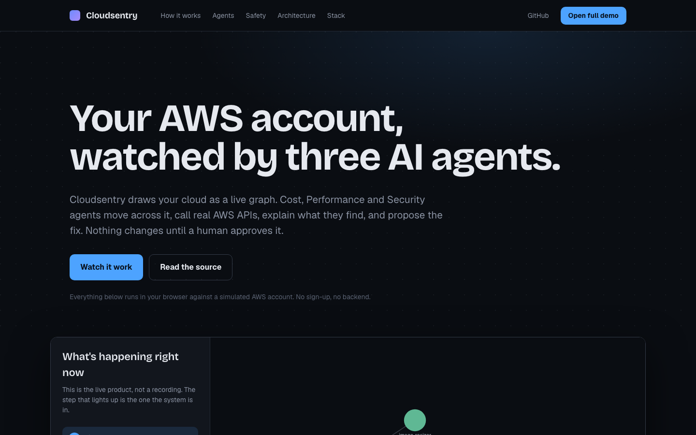
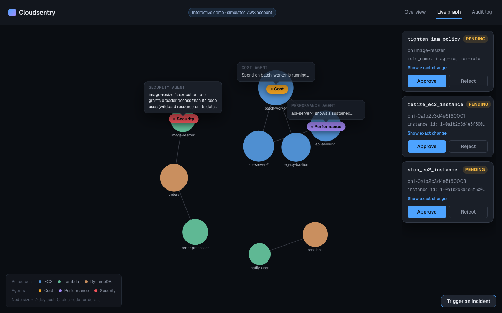
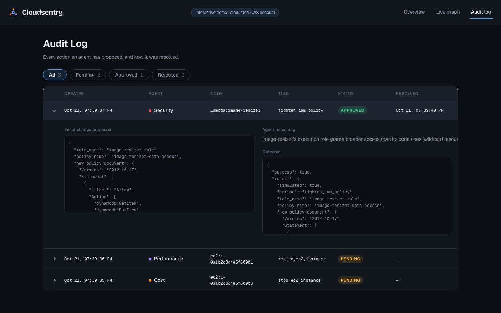
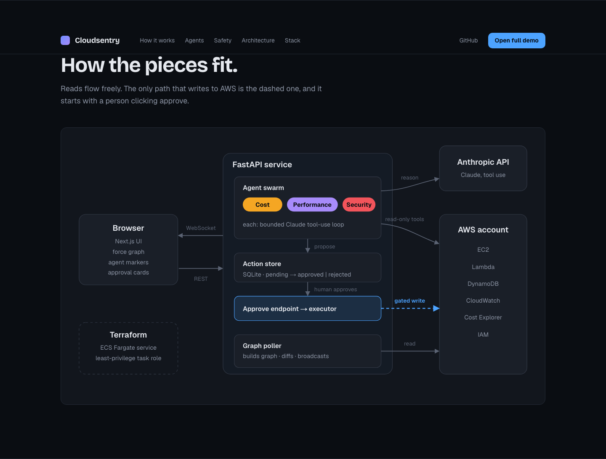

# Cloudsentry

**Your AWS account as a live graph, watched by three AI agents.**

Cloudsentry renders real AWS resources (EC2, Lambda, DynamoDB) as a live force-directed graph.
Three Claude-powered agents — **Cost**, **Performance**, **Security** — continuously pick a node,
call real AWS APIs, annotate what they find, and propose a fix. Nothing mutates your account
until a human clicks **Approve**; every decision lands in an audit log.

**[▶ Live demo](https://sakar1601.github.io/cloudsentry/)** — runs in your browser, nothing to install.





| Audit log of every proposed action | Architecture |
|---|---|
|  |  |

## Try it (no AWS account, no API key)

**Static demo — no server at all.** The whole UI, with a simulated AWS account and agents running in
your browser, builds to plain static files:

```bash
make static && npx serve frontend/out        # or push to GitHub: Pages deploys it (see below)
```

**Full stack in Docker** — the real backend in demo mode:

```bash
docker compose up --build        # then open http://localhost:3000
```

This starts **demo mode**: a fictional AWS account and scripted agents run through the *same*
poller, WebSocket stream, action store and approval API as production — only the AWS and LLM
calls are swapped out (`backend/app/demo/`). Approving an action is simulated.
The static build uses a TypeScript port of the same scenario (`frontend/lib/demo/engine.ts`) behind
`frontend/lib/api.ts`, selected by `NEXT_PUBLIC_STATIC_DEMO=1`.

Without Docker: `make install`, then `make backend` and `make frontend` in two terminals.

## How it works

```
 Next.js UI  ◄── WebSocket (graph deltas, agent moves, findings) ──┐
 (force graph)  ── REST: approve / reject / audit ──►  FastAPI ────┤
                                                                   │
   Graph poller ── boto3 (EC2, Lambda, DynamoDB, CloudWatch,       │
   (diffs → events)  Cost Explorer, IAM) ──► in-memory graph ──────┤
                                                                   │
   Agent swarm: Cost │ Performance │ Security                      │
   each = Claude tool-use loop over a scoped read-only tool set ───┘
        └─ action tools only *propose* → SQLite pending_actions → human approve → boto3 write
```

- **Graph builder** — polls AWS, derives edges (shared VPC, Lambda env-var references, IAM access),
  diffs snapshots, and streams only deltas to clients.
- **Agent swarm** — each agent selects a node (cost/latency spike vs. rolling baseline, or round-robin for
  security), then runs a bounded Claude tool-use loop and emits a finding.
- **Approval gate** — action tools (`stop_ec2_instance`, `resize_ec2_instance`, `tighten_iam_policy`)
  never touch AWS; they write a pending action. Only the approve endpoint executes it.
- **Infra** — Terraform for a least-privilege task role and an ECS Fargate service (`infra/`).

Full design: [docs/spec.md](docs/spec.md).

## Run against a real AWS account

```bash
cp backend/.env.example backend/.env      # add ANTHROPIC_API_KEY and AWS profile/region
cd backend && python3 -m venv .venv && source .venv/bin/activate && pip install -e '.[dev]'
set -a && source .env && set +a
uvicorn app.main:app --port 8000
cd ../frontend && cp .env.local.example .env.local && npm ci && npm run dev
```

Needs read access to EC2/Lambda/DynamoDB/CloudWatch/Cost Explorer/IAM (the policy in
`infra/terraform/iam/` is the reference). To keep the account lively, run
`backend/scripts/traffic_generator.py <function-names>` as a separate process.
Approving an action in live mode **really executes it** — use a sandbox account.

## Repo layout

```
backend/   FastAPI app: graph/ (poller, diff, edges), agents/, actions/ (store, executor),
           tools/ (boto3 wrappers), demo/ (fixture account + scripted agents), tests/ (118)
frontend/  Next.js 16 + TypeScript: graph canvas, agent overlays, action cards, audit page (22 tests)
infra/     Terraform: iam/ (task role), ecs/ (Fargate service)
docs/      design spec, screenshots
```

## Tests & CI

`make test` runs pytest and vitest. GitHub Actions (`.github/workflows/ci.yml`) also type-checks and
builds the frontend and validates the Terraform modules.

## Status & known gaps

Working end to end locally (live and demo). The ECS service has no load balancer yet, so a public
cloud deployment of the backend is not wired up — see [infra/README.md](infra/README.md).
